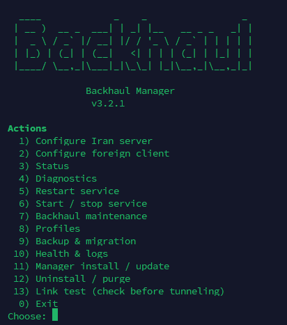

<div align="center">

<h1 align="center">Backhaul Manager</h1>

<!-- repo-badges:start -->
<p align="center">
  <a href="https://hits.sh/github.com/power0matin/backhaul-manager/"></a>
  <a href="https://github.com/power0matin/backhaul-manager/stargazers"></a>
  <a href="https://github.com/power0matin/backhaul-manager/forks"></a>
  <a href="https://github.com/power0matin/backhaul-manager/issues"></a>
  <a href="LICENSE"></a>
</p>
<!-- repo-badges:end -->

<p><strong>An interactive installer and operations manager for Backhaul reverse tunnels.</strong></p>

<p>
  <a href="https://github.com/power0matin/backhaul-manager/actions/workflows/shell.yml"></a>
  <a href="https://github.com/power0matin/backhaul-manager/blob/main/LICENSE"></a>
  
  
  
</p>

<p>
  <a href="https://matinshahabadi.ir/projects/backhaul-manager/">Official project page</a> ·
  Maintainer: <a href="https://github.com/power0matin">@power0matin</a> ·
  <a href="./README.md">English</a> ·
  <a href="./README.fa.md">فارسی</a>
</p>

</div>

</div>

<div align="center">
  <a href="./imgs/preview_v3.2.1.png">
    
  </a>
  <p><sub>Backhaul Manager v3.2.1 · Interface preview · Click to view full size</sub></p>
</div>

Backhaul Manager configures and maintains both sides of a Backhaul reverse tunnel: the Iran-side server and the foreign-side client. It adds guided setup, named profiles, source migration, validated backups, health checks, rollback, and command-line operations to the underlying Backhaul binary.

It supports [`power0matin/Backhaul`](https://github.com/power0matin/Backhaul) and the [`Musixal/Backhaul`](https://github.com/Musixal/Backhaul) upstream. It can be used alongside Xray, V2Ray, Marzban, 3x-ui/Sanaei, Hiddify, and similar software, but **it does not configure those applications themselves**.

> **Safety note:** The manager requires root privileges for installation and service-management operations. Review the script before running downloaded code as root. The quick-install command downloads the current `main` version, not a pinned or cryptographically signed release. The manager never changes firewall rules automatically.

## Contents

- [Features](#features)
- [Requirements](#requirements)
- [Quick start](#quick-start)
- [Setup workflow](#setup-workflow)
- [Supported transports](#supported-transports)
- [Pre-tunnel Link Test](#pre-tunnel-link-test)
- [Profiles, backups, and migration](#profiles-backups-and-migration)
- [Command-line operations](#command-line-operations)
- [Files and defaults](#files-and-defaults)
- [Safety and operational limits](#safety-and-operational-limits)
- [Troubleshooting](#troubleshooting)
- [Development and tests](#development-and-tests)
- [Roadmap](#roadmap)
- [Contributing and license](#contributing-and-license)

## Features

| Area                                            | What it provides                                                                                                                               |
| ----------------------------------------------- | ---------------------------------------------------------------------------------------------------------------------------------------------- |
| **Both tunnel roles**                           | Configure the Iran-side server or the foreign-side client with the same script.                                                                |
| **Selectable Backhaul source**                  | Choose `power0matin/Backhaul` (the recommended default) or `Musixal/Backhaul` during setup.                                                    |
| **Seven transports**                            | `tcp`, `tcpmux`, `udp`, `ws`, `wss`, `wsmux`, and `wssmux`. `wsmux` is the general default; test your own route before choosing.               |
| **Standard and Advanced modes**                 | Configure port ranges and mappings, resource-aware tuning, PROXY protocol, UDP-over-tunnel, and source-specific options.                       |
| **Named profiles**                              | Run separate configurations and services such as `backhaul-edge-1.service` while sharing one Backhaul binary and source.                       |
| **Pre-tunnel Link Test**                        | Test all supported transports, a chosen control port and transport, or TCP reachability alone before committing to a tunnel setup.             |
| **Transactional changes**                       | Validate inputs, create snapshots, write files atomically, verify service health, and attempt rollback after failed configuration or upgrades. |
| **Multi-profile upgrades and source migration** | Check compatibility, protect against unapproved downgrades, verify previously active profiles, and roll back on failure.                       |
| **Backup and host migration**                   | Create checksum-verified backups, import/export portable archives, and migrate a managed installation over SSH.                                |
| **Health and metrics**                          | Inspect service state, the current process ID, listeners/control-channel health, logs, restart information, and supported metrics.             |
| **Safer secret handling**                       | Generate a cryptographically random token, hide token input, escape TOML values, and keep sensitive files/logs restricted.                     |
| **Concurrent-operation lock**                   | Use `flock` to prevent concurrent manager sessions from changing shared installation state.                                                    |
| **Firewall-aware guidance**                     | Detect `ufw` or `firewalld` and print relevant ports or commands without changing the firewall policy.                                         |
| **CLI maintenance**                             | Run common status, diagnostics, service, backup, profile, upgrade, and migration tasks without navigating the interactive menu.                |

## Requirements

- Linux with `systemd` running as PID 1.
- Bash 5 or newer.
- `x86_64`/AMD64 or `arm64`/AArch64.
- Root access for installation and service operations.
- Standard system tools, including `curl`, `tar`, `flock`, `systemctl`, `journalctl`, `ss`, `awk`, `grep`, `sed`, `sha256sum`, and GNU/coreutils utilities.
- **For Link Test:** `python3` and `openssl` are required for the full pre-tunnel test.
- `nc`/netcat is optional; it is used for some client reachability checks.
- `ssh` and `scp` are optional and only needed for guided server-to-server migration. Configure custom SSH ports and keys in `~/.ssh/config`.
- `jq` is optional and makes PowerMatin `/stats` output easier to read.
- The production `wss` and `wssmux` transports require a certificate and private key on the server.

The manager checks required commands and exits with an error if a mandatory dependency is missing. On Debian/Ubuntu, the script's diagnostic hint includes a package-install command for common missing tools.

## Quick start

### Fastest: one-command launch

These commands start the interactive manager directly from the current `main` branch. They download and execute the script immediately, without a review step. To inspect the code before running it with root privileges, use the safer method below.

If you are already logged in as `root`:

```bash
bash <(curl -fsSL https://raw.githubusercontent.com/power0matin/backhaul-manager/main/backhaul-manager.sh)
```

For a non-root shell:

```bash
curl -fsSL https://raw.githubusercontent.com/power0matin/backhaul-manager/main/backhaul-manager.sh | sudo bash
```

Do **not** use `sudo bash <(curl ...)`: `sudo` may close the `/dev/fd/...` descriptor used by process substitution. The pipe-to-`sudo bash` form is the supported alternative when privilege elevation is needed.

### Safer: download, review, then run

Download the script and inspect it before execution:

```bash
curl -fsSL https://raw.githubusercontent.com/power0matin/backhaul-manager/main/backhaul-manager.sh -o backhaul-manager.sh
less backhaul-manager.sh
sudo bash ./backhaul-manager.sh
```

The last command starts the interactive manager. If you are already logged in as `root`, omit `sudo`.

Both launch methods use the current `main` version, not a pinned or cryptographically signed release. To install or update the optional global `backhaul-manager` command after reviewing the script, use **Manager install / update** in the interactive menu or `--self-update`. The self-update mechanism performs syntax/version checks and rejects downgrades, but it is not a cryptographically signed update channel.

## Setup workflow

1. Run the manager on the server that will act as the Iran-side endpoint and choose **Configure Iran server**.
2. Choose a Backhaul release source. `power0matin/Backhaul` is the recommended default; `Musixal/Backhaul` is also available.
3. Configure the foreign-side machine as the client using the corresponding source/version, token, transport, and control port.
4. Check the status and diagnostics on both sides. Use Link Test first when you need to assess a path before creating a production tunnel.
5. Confirm the required ports in the host firewall and provider security group. The manager prints guidance but does not apply firewall changes.

### Interactive menu

The current menu includes these top-level actions:

```text
  1) Configure Iran server
  2) Configure foreign client
  3) Status
  4) Diagnostics
  5) Restart service
  6) Start / stop service
  7) Backhaul maintenance
  8) Profiles
  9) Backup & migration
 10) Health & logs
 11) Manager install / update
 12) Uninstall / purge
 13) Link test (check before tunneling)
  0) Exit
```

Re-running server or client configuration for a managed installation creates snapshots before changing files. Configuration files are written atomically, and a failed service start triggers rollback where possible.

### Source selection and compatibility

The selected source is saved in the manager's state and reused for later upgrades. All profiles on a host share one Backhaul binary, so changing its source or version affects the installation as a whole, not just the selected profile.

If an existing binary has no recorded source, the manager reports `unknown` instead of guessing. Record the repository that actually supplied it through **Backhaul maintenance → Record current source** or `--set-source REPO` before source-dependent maintenance.

## Supported transports

These are the seven transport names currently supported by the manager and its supported Backhaul sources.

| Transport | Description                                   | Extra production server material |
| --------- | --------------------------------------------- | -------------------------------- |
| `wsmux`   | Multiplexed WebSocket; general starting point | None beyond normal configuration |
| `tcpmux`  | Multiplexed TCP                               | None beyond normal configuration |
| `tcp`     | Direct TCP transport                          | None beyond normal configuration |
| `ws`      | WebSocket transport                           | None beyond normal configuration |
| `wssmux`  | TLS-encrypted multiplexed WebSocket           | TLS certificate and private key  |
| `wss`     | TLS-encrypted WebSocket                       | TLS certificate and private key  |
| `udp`     | UDP transport                                 | None beyond normal configuration |

For `ws`, `wss`, `wsmux`, and `wssmux`, the client can optionally use Backhaul's `edge_ip` setting where supported by the selected source. Transport availability and configuration fields can vary by Backhaul release; the manager checks source/config compatibility during maintenance and migration.

### Ports and mappings

Standard mode accepts direct tunnel ports such as `443,2052,2082`. Advanced mode supports ranges and mappings, for example:

```text
4000-4100
4000=5000
443=127.0.0.1:8443
443=[2001:db8::10]:8443
```

The manager validates port values and checks for control-port conflicts. These examples illustrate accepted mapping forms; select values that match your network design and the syntax supported by the chosen Backhaul source.

## Pre-tunnel Link Test

Use **menu option 13** before relying on a new server pair. Link Test uses temporary Backhaul configurations and listeners to evaluate the path without replacing the manager's saved production configuration or managed services.

The Link Test submenu provides four modes:

1. **Iran server: test all transports.** Starts temporary listeners for the supported transports and displays a short pairing code.
2. **Foreign server: run the test.** Enter the Iran server's address and the pairing code. The manager separately reports TCP control-port reachability, pairing verification, Backhaul handshake, forwarding, data round-trip, and stability, then recommends a transport if a tested path passes.
3. **Iran server: test one exact port and transport.** Use this when the intended control port matters—for example, TCP port `443`. It uses a separate forwarding test port and an optional verification port. A port already in use is reported and is not taken over.
4. **Foreign server: TCP reachability only.** This is a basic port-connectivity check; it does **not** verify a Backhaul handshake or data forwarding.

**Important limits:**

- Link Test checks only the ports and transports it actually tests. A pass is evidence about that path at that time, not a guarantee of production uptime, performance, or end-to-end application behavior.
- Temporary test ports may need to be allowed in the host firewall and provider security group. The manager prints the exact ports and protocols; it does not open them automatically.
- Stop the listener when testing is complete and remove any temporary firewall allowances that are no longer needed.
- A passing TLS transport test does not replace configuring and validating the real production certificate, private key, and certificate chain for `wss` or `wssmux`.
- Python 3 and OpenSSL are required for the full Link Test. If those dependencies or the required Backhaul asset cannot be prepared, the test cannot complete.

## Profiles, backups, and migration

- The legacy/default profile retains `/root/backhaul/config.toml` and `backhaul.service` for backward compatibility.
- Named profiles live under `/root/backhaul/profiles/<name>/` and use services such as `backhaul-edge-1.service`.
- Legacy root-level Backhaul TOML files can be detected and listed. Discovery is read-only; choose **Profiles → Adopt legacy tunnel** to explicitly convert a detected configuration into a named profile.
- A profile's `*` marker means it is selected for manager actions. It does not mean other profiles are stopped. Each profile reports its own state, including `active`, `stopped`, `no-unit`, or `mismatch`.
- Service actions refuse profiles marked `mismatch`. Shared-binary operations such as upgrade, source migration, restore, and uninstall can be blocked until detected legacy tunnels are brought under profile management.
- Full schema-2 backups include managed profiles, detected root-level legacy tunnels, service active/enabled state, shared binary/source state, restorable unit information, and readable TLS material. Backup snapshots are checksum-verified before success is reported.
- Portable `.tar.gz` imports validate paths, member types/count, and size limits before privileged extraction. **Backup bundles contain secrets and are not signed or authenticated; import only bundles you trust.**
- Guided server-to-server migration transfers a portable bundle over SSH and protects the transferred file's permissions.
- Source migration checks profile compatibility and stages configuration changes before committing. Downgrades or changes that need adaptation require explicit confirmation in the interactive workflow.

## Command-line operations

The interactive menu is the default. Common maintenance operations can also be called directly from a terminal:

```bash
# Status, diagnostics, and metrics
sudo ./backhaul-manager.sh --status
sudo ./backhaul-manager.sh --diagnose
sudo ./backhaul-manager.sh --metrics
sudo ./backhaul-manager.sh --profile edge-1 --status

# Service control and Backhaul upgrade
sudo ./backhaul-manager.sh --start
sudo ./backhaul-manager.sh --stop
sudo ./backhaul-manager.sh --restart
sudo ./backhaul-manager.sh --upgrade            # latest from the recorded source
sudo ./backhaul-manager.sh --upgrade v0.7.2     # pin a release tag

# Source and profile management
sudo ./backhaul-manager.sh --compat power0matin/Backhaul
sudo ./backhaul-manager.sh --set-source power0matin/Backhaul
sudo ./backhaul-manager.sh --migrate-source Musixal/Backhaul
sudo ./backhaul-manager.sh --adopt-legacy
sudo ./backhaul-manager.sh --list-profiles
sudo ./backhaul-manager.sh --select-profile edge-1

# Backup, export/import, and logs
sudo ./backhaul-manager.sh --backup
sudo ./backhaul-manager.sh --list-backups
sudo ./backhaul-manager.sh --export /root/backhaul-portable.tar.gz
sudo ./backhaul-manager.sh --import /root/backhaul-portable.tar.gz
sudo ./backhaul-manager.sh --restore-backup backup-YYYYMMDD-HHMMSS-label-PID
sudo ./backhaul-manager.sh --logs 100
sudo ./backhaul-manager.sh --follow-logs

# Optional global command installation/update
sudo ./backhaul-manager.sh --self-update
./backhaul-manager.sh --version
./backhaul-manager.sh --help
```

`--upgrade` defaults to the latest release from the recorded source and refuses non-interactive downgrades. Non-interactive `--migrate-source` also refuses downgrades and migrations that need config adaptation; use the interactive manager to review and explicitly approve those changes. The `--profile NAME` prefix can be used with supported profile-scoped operations.

## Files and defaults

### Important paths

| Path                                          | Purpose                                    |
| --------------------------------------------- | ------------------------------------------ |
| `/opt/backhaul/backhaul`                      | Installed Backhaul binary                  |
| `/root/backhaul/config.toml`                  | Default profile configuration (`0600`)     |
| `/root/backhaul/backhaul-info.txt`            | Local setup/connection summary (`0600`)    |
| `/root/backhaul/profiles/<name>/config.toml`  | Named profile configuration (`0600`)       |
| `/etc/systemd/system/backhaul.service`        | Default managed service unit               |
| `/etc/systemd/system/backhaul-<name>.service` | Named profile service unit                 |
| `/var/lib/backhaul-manager/backups/`          | Timestamped rollback snapshots and backups |
| `/var/lib/backhaul-manager/backhaul-source`   | Selected Backhaul source metadata          |
| `/var/lib/backhaul-manager/active-profile`    | Selected profile name                      |
| `/var/log/backhaul-manager/`                  | Per-run manager logs (`0600`)              |
| `/usr/local/sbin/backhaul-manager`            | Optional global manager command            |

### Standard-mode defaults

| Setting            | Default                       |
| ------------------ | ----------------------------- |
| Control port       | `8080`                        |
| Tunnel ports       | `2052,2082,8002,443`          |
| Transport          | `wsmux`                       |
| Backhaul source    | `power0matin/Backhaul`        |
| `keepalive_period` | `20` for non-UDP transports   |
| Server `heartbeat` | `20`                          |
| `channel_size`     | `2048`                        |
| `connection_pool`  | `8`                           |
| `mux_con`          | `8` for mux server transports |
| `mux_version`      | `1` for mux transports        |
| `web_port`         | `0` (disabled)                |
| `log_level`        | `info`                        |

Advanced tuning can change pool, channel, mux, buffer, and concurrency values. `safe` targets lower resource use, `balanced` follows the defaults above, and `throughput` raises concurrency/buffer limits for stronger hosts. Automatic tuning chooses a profile based on available CPU and RAM. Client configs do not write a `heartbeat` key because the current Backhaul client configuration schema does not expose it. The web monitor is disabled by default. PowerMatin Advanced mode can enable authenticated metrics on loopback; metrics are not exposed automatically for Musixal v0.7.2 because that release cannot configure a safe loopback bind/auth policy.

## Safety and operational limits

- Tokens are generated from cryptographically random bytes and encoded as 48 hexadecimal characters. Custom token input is hidden and TOML-sensitive values are escaped before being written.
- Config and info files, backups, and run logs use restrictive permissions. Tokens are not written to the manager's run log.
- Downloads use HTTPS, timeouts/retries and size limits. Release archives are validated, only the expected `backhaul` binary is extracted, and the binary's version output is checked before replacement.
- Config and binary changes use temporary files and atomic replacement. Failed operations restore snapshots where possible; an interrupted active transaction also attempts rollback.
- The manager checks the effective systemd `ExecStart`, including drop-in overrides, when matching a service to a managed config. It avoids treating an unrelated service as a managed Backhaul tunnel.
- Imported archives and saved systemd units are validated before privileged restore; unsafe paths, archive members, and executable hooks are rejected.
- Mutating manager operations use a non-blocking `flock` to prevent concurrent writes.
- Firewall policy is never changed automatically.
- The optional self-update process checks syntax and version and refuses downgrades, but it is **not cryptographically signed**. Review the source and your trust assumptions before using it.

These protections reduce common failure modes; they do not remove the need for backups, host-level security, correct firewall configuration, or review before running privileged code.

## Troubleshooting

Start with diagnostics:

```bash
sudo ./backhaul-manager.sh --diagnose
sudo ./backhaul-manager.sh --status
sudo ./backhaul-manager.sh --logs 100
sudo ./backhaul-manager.sh --follow-logs
```

Common causes of a failed setup include:

- The Iran-side control port is blocked by a host firewall, provider security group, or upstream network.
- Another process is already listening on a configured port.
- Server and client use different tokens, transports, control ports, or incompatible Backhaul sources/versions.
- A TLS transport points to a missing or unreadable certificate or private key.
- The selected source has no release asset for the requested version or CPU architecture.
- A source/version migration encounters a profile with unsupported configuration fields.

Run Link Test (menu option 13) when you need to distinguish port reachability from a successful Backhaul handshake and data forwarding. A TCP-only result is not proof that a Backhaul tunnel works.

## Development and tests

Run these checks from the repository root. ShellCheck is a separate prerequisite for lint commands.

```bash
# Bash syntax checks used by CI
bash -n backhaul-manager.sh test.sh tests/test.sh tests/test-v311.sh tests/test-v312.sh tests/test-linktest.sh

# Static analysis used by CI
shellcheck backhaul-manager.sh test.sh tests/test-v311.sh tests/test-v312.sh tests/test-linktest.sh tests/test-linktest-integration.sh
shellcheck --exclude=SC2317,SC2329,SC2034 tests/test.sh

# Regression and failure-injection suites used by CI
bash test.sh
bash tests/test.sh
bash tests/test-v311.sh
bash tests/test-v312.sh
bash tests/test-linktest.sh
```

GitHub Actions runs syntax checks, ShellCheck, and the listed regression/failure-injection suites on pushes to `main` and pull requests. `tests/test-linktest-integration.sh` is linted by CI but is an optional real-binary integration suite; it is not part of the default CI test loop. It runs against loopback only and does not validate a real multi-host path. To run it, provide whichever real binaries you want to test: `BH_BIN_POWER=/path/to/power0matin/backhaul BH_BIN_MUSIXAL=/path/to/Musixal/backhaul bash tests/test-linktest-integration.sh`.

## Roadmap

- [x] All seven supported Backhaul transports
- [x] Secure token generation and safer secret handling
- [x] Transactional configuration/binary changes with rollback
- [x] Status, diagnostics, service controls, logs, and upgrades
- [x] CLI maintenance operations
- [x] Automated syntax, lint, regression, and failure-injection tests
- [x] Advanced port ranges and mapping rules
- [x] Standard/Advanced modes with resource-aware tuning
- [x] Multiple named profiles and services
- [x] Source migration with compatibility checks and rollback
- [x] Full backup/restore, portable import/export, and guided SSH migration
- [x] Health metrics and supported `/stats` integration
- [x] Optional global Manager install/self-update command
- [x] Pre-tunnel Link Test, including exact-port and TCP-only reachability modes
- [ ] Fully unattended server/client configuration flags

See [CHANGELOG.md](./CHANGELOG.md) for release history and unreleased changes.

## Contributing and license

Bug reports and pull requests are welcome through [GitHub Issues](https://github.com/power0matin/backhaul-manager/issues) and [Pull Requests](https://github.com/power0matin/backhaul-manager/pulls). For a large behavioral change, open an issue first so the proposal can be checked against the supported Backhaul configuration model.

This project is licensed under the [MIT License](./LICENSE). Backhaul itself is a separate project with its own source and license. See the [official project page](https://matinshahabadi.ir/projects/backhaul-manager/) for the project overview.

## Contact

**Matin Shahabadi**

- Website: [matinshahabadi.ir](https://matinshahabadi.ir)
- Email: [me@matinshahabadi.ir](mailto:me@matinshahabadi.ir)
- GitHub: [power0matin](https://github.com/power0matin)
- LinkedIn: [matin-shahabadi](https://www.linkedin.com/in/matin-shahabadi)

<p align="center">
  <b>If this helped you, consider giving it a star!</b><br>
  <sub>Your support keeps the project alive and helps others find it.</sub>
</p>

<!-- Copy-paste in your Readme.md file -->
<p align="center">
  <a href="https://next.ossinsight.io/widgets/official/analyze-repo-stars-history?repo_id=1322866555" target="_blank" style="display: block" align="center">
    <picture>
      <source media="(prefers-color-scheme: dark)" srcset="https://next.ossinsight.io/widgets/official/analyze-repo-stars-history/thumbnail.png?repo_id=1322866555&amp;image_size=auto&amp;color_scheme=dark" width="721" height="auto">
      
    </picture>
  </a>
</p>

<!-- Made with [OSS Insight](https://ossinsight.io/) -->

<p align="center">
  Created by <a href="https://github.com/power0matin">power0matin</a>
</p>
